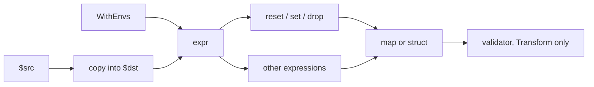

# io-sankey

[](https://pkg.go.dev/github.com/RealAlexandreAI/io-sankey)
[](https://github.com/RealAlexandreAI/io-sankey/actions/workflows/ci.yaml)
[](https://github.com/RealAlexandreAI/io-sankey/blob/main/LICENSE)

Go library that maps one value onto another JSON object with [expr](https://github.com/expr-lang/expr) expressions, then optionally checks the result with [validator v10](https://github.com/go-playground/validator).

[**中文**](README.zh.md)

## What it does

`SankeyTransformer` copies `src` into a destination map, then runs a list of expressions against that copy. Expressions that start with `reset(`, `set(`, or `drop(` rewrite the destination JSON. Every other expression is evaluated for its side effects (a custom function, a log call) and does not replace the destination.

`$src` is the value you passed in. `$dst` is reserved: io-sankey binds a `context.Context` there and overwrites anything you put under that name in `WithEnvs`. The destination JSON string is the context value under `dstCtxKey`, not the `$dst` binding itself. Other env keys are available as variables inside expressions.




`Map` returns `map[string]any`. `Transform` decodes that map into `dst` and then calls `validator.Struct`. `Map` does not validate.

## Install

Go 1.25 or later (`go 1.25.0` in `go.mod`).

```shell
go get github.com/RealAlexandreAI/io-sankey
```

Latest tag is [v0.0.4](https://github.com/RealAlexandreAI/io-sankey/releases/tag/v0.0.4). CI on `main` runs `go test -count=1 -race ./...` with Go 1.25.

## API

```go
func NewSankeyTransformer(opts ...SankeyOption) *SankeyTransformer

func WithExpressions(expressions ...string) SankeyOption
func WithEnvs(envs map[string]interface{}) SankeyOption
func WithExprOptions(exprOptions ...expr.Option) SankeyOption

func (s *SankeyTransformer) Map(src any) (map[string]any, error)
func (s *SankeyTransformer) Transform(src any, dst any) error
```

| Option | Effect |
| --- | --- |
| `WithExpressions` | Appends expressions. They run in order. |
| `WithEnvs` | Copies keys into the expr environment. `$src` and `$dst` are overwritten on each `Map` call. `$dst` is the context, not the JSON string. |
| `WithExprOptions` | Extra [expr options](https://github.com/expr-lang/expr), including `expr.Function` for custom functions. Appended after the builtins. |

Builtins are compiled with `expr.AllowUndefinedVariables()` and `expr.Optimize(true)`. `reset`, `set`, and `drop` also receive a context patch so the first argument is the current `$dst` context.

`Map` decodes `src` with [mapstructure](https://github.com/mitchellh/mapstructure), deep-copies it with [copier](https://github.com/jinzhu/copier) (`IgnoreEmpty`, `DeepCopy`), and marshals the copy with [sonic](https://github.com/bytedance/sonic). `set` and `drop` then edit that JSON string.

## Expressions

Only expressions whose text starts with `reset(`, `set(`, or `drop(` update `$dst`. A call nested inside another expression does not.

### reset()

Replaces `$dst` with `{}`. Without `reset()`, `$dst` starts as a copy of `$src`.

### set(key, value)

Writes `value` at `key` with [sjson `SetOptions`](https://github.com/tidwall/sjson) (`Optimistic`, `ReplaceInPlace`). `key` is an sjson path, so `set("friend.last", "Anderson")` creates `friend.last`. The current `$dst` JSON is the document; you do not pass it yourself.

`set` ignores the error from sjson and keeps the previous JSON string when the path is rejected.

### drop(key)

Deletes `key` with [sjson `Delete`](https://github.com/tidwall/sjson). Same as `set`: the document is the current `$dst`, and a delete error is ignored.

## Builtins

These are expr functions, registered on every transformer. [expr operators and builtins](https://expr-lang.org/docs/language-definition) are available as well.

| Name | Signature | Returns |
| --- | --- | --- |
| `uuidv4` | `uuidv4() string` | `uuid.NewString()` from [google/uuid](https://github.com/google/uuid). |
| `jsonrepair` | `jsonrepair(string) string` | Repaired JSON from [json-repair](https://github.com/RealAlexandreAI/json-repair). First argument must be a string. |
| `sprig` | `sprig(string, any) string` | Renders the first argument as a Go `text/template` with the [Sprig](https://masterminds.github.io/sprig/) `TxtFuncMap`. The second argument is the template data. |
| `jsonpath` | `jsonpath(string, string) []string` | [ajson](https://github.com/spyzhov/ajson) JSONPath over the first argument (a JSON string). Each match is `node.String()`. |
| `jq` | `jq(any, string) []any` | [gojq](https://github.com/itchyny/gojq) query (second argument) over the first. The first argument must be `map[string]any`, `[]any`, or `[]map[string]any`. Anything else returns an error. |

## Custom functions

Pass `expr.Function` through `WithExprOptions`. The function is then a normal expr call.

```go
st := NewSankeyTransformer(
	WithExpressions(
		"reset()",
		`myAccessLog()`,
		`set("KeyBuiltinFunc", uuidv4())`,
	),
	WithExprOptions(
		expr.Function(
			"myToInt",
			func(params ...any) (any, error) {
				return strconv.Atoi(params[0].(string))
			},
			new(func(string) int),
		),
		expr.Function(
			"myAccessLog",
			func(params ...any) (any, error) {
				fmt.Println("access at: " + time.Now().String())
				return nil, nil
			},
			new(func() any),
		),
	),
)
```

## Validation

`Transform` runs `validator.New(validator.WithRequiredStructEnabled())` on `dst` after decoding. Struct tags from [validator v10](https://github.com/go-playground/validator) apply. A validation error is returned as `error validating destination structure`. `Map` skips this step.

## Example

Same sequence as `Test_Readme` in `sankey_test.go`.

```go
var srcData = MixedDataTypes{
	IntValue:    42,
	FloatValue:  3.14,
	StringValue: "Hello, World!",
	BoolValue:   true,
	ArrayValue:  [3]int{1, 2, 3},
	SliceValue:  make([]int, 0, 5),
	MapValue:    map[string]int{"one": 1, "two": 2},
	IntPtrValue: func() *int { temp := 100; return &temp }(),
	StructValue: struct {
		Name string
		Age  int
	}{"Alice", 30},
}

st := NewSankeyTransformer(
	WithExpressions(
		"reset()",
		`set("name", "Tom")`,
		`set("friend.last", "Anderson")`,
		`drop("name")`,
		`set("keyFromSrc", $src.StructValue)`,
		`set("keyFromExternalEnv", $externalKey)`,
		`set($externalKey, externalKey)`,
		`myAccessLog()`,
		`set("KeyBuiltinFunc", uuidv4())`,
		`set("KeyCustomFunc", myToInt(paramStringInt))`,
	),
	WithEnvs(map[string]any{
		"$externalKey":   "eValue1",
		"externalKey":    "eValue2",
		"paramStringInt": "123",
	}),
	WithExprOptions(
		expr.Function(
			"myToInt",
			func(params ...any) (any, error) {
				return strconv.Atoi(params[0].(string))
			},
			new(func(string) int),
		),
		expr.Function(
			"myAccessLog",
			func(params ...any) (any, error) {
				fmt.Println("access at: " + time.Now().String())
				return nil, nil
			},
			new(func() any),
		),
	),
)

dst, err := st.Map(srcData)
```

| Step | What it reads | `$dst` after the step |
| --- | --- | --- |
| `Map` / `Transform` start | `$src`, copied into `$dst` | same fields as `srcData` |
| `reset()` | — | `{}` |
| `set("name", "Tom")` | literal | `{"name":"Tom"}` |
| `set("friend.last", "Anderson")` | sjson path | `{"name":"Tom","friend":{"last":"Anderson"}}` |
| `drop("name")` | sjson path | `{"friend":{"last":"Anderson"}}` |
| `set("keyFromSrc", $src.StructValue)` | `$src` | adds `keyFromSrc` = `{"Name":"Alice","Age":30}` |
| `set("keyFromExternalEnv", $externalKey)` | env `$externalKey` | adds `keyFromExternalEnv` = `"eValue1"` |
| `set($externalKey, externalKey)` | env key and env value | adds `"eValue1":"eValue2"` |
| `myAccessLog()` | custom function, no return used | prints `access at: ` plus `time.Now()`; `$dst` unchanged |
| `set("KeyBuiltinFunc", uuidv4())` | builtin | adds a new UUID string |
| `set("KeyCustomFunc", myToInt(paramStringInt))` | custom function | adds `KeyCustomFunc` = `123` |
| return | — | `Map` returns the map. `Transform` decodes it into `dst` and validates. |

The UUID above is a new value on every run. The test does not pin it.

## License

[GNU General Public License v3](LICENSE). See `LICENSE`.
