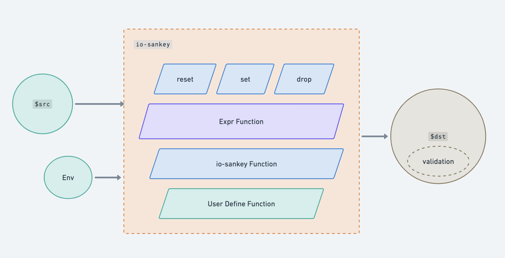
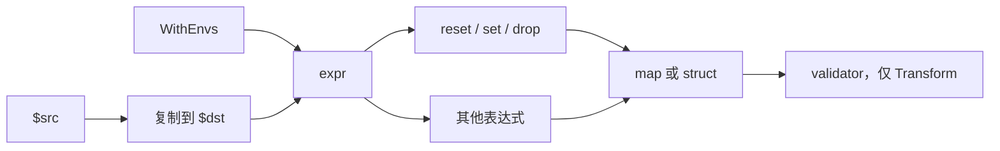

# io-sankey

[](https://pkg.go.dev/github.com/RealAlexandreAI/io-sankey)
[](https://github.com/RealAlexandreAI/io-sankey/actions/workflows/ci.yaml)
[](https://github.com/RealAlexandreAI/io-sankey/blob/main/LICENSE)

用 [expr](https://github.com/expr-lang/expr) 表达式把一个值映射成另一个 JSON 对象，再用 [validator v10](https://github.com/go-playground/validator) 做可选校验的 Go 库。

[**English**](README.md)

## 做什么

`SankeyTransformer` 先把 `src` 复制成目标 map，再按顺序执行表达式。文本以 `reset(`、`set(`、`drop(` 开头的表达式改写目标 JSON。其余表达式只为副作用求值（自定义函数、打日志），不会替换目标。

`$src` 是传入的值。`$dst` 是保留名：io-sankey 在这里绑定一个 `context.Context`，并覆盖 `WithEnvs` 里同名的键。目标 JSON 字符串是 context 里 `dstCtxKey` 的值，不是 `$dst` 绑定本身。其他环境变量键可以在表达式里当变量用。





`Map` 返回 `map[string]any`。`Transform` 把这个 map 解码进 `dst`，再调用 `validator.Struct`。`Map` 不校验。

## 安装

需要 Go 1.25 或更高版本（`go.mod` 写的是 `go 1.25.0`）。

```shell
go get github.com/RealAlexandreAI/io-sankey
```

最新 tag 是 [v0.0.4](https://github.com/RealAlexandreAI/io-sankey/releases/tag/v0.0.4)。`main` 上的 CI 用 Go 1.25 跑 `go test -count=1 -race ./...`。

## API

```go
func NewSankeyTransformer(opts ...SankeyOption) *SankeyTransformer

func WithExpressions(expressions ...string) SankeyOption
func WithEnvs(envs map[string]interface{}) SankeyOption
func WithExprOptions(exprOptions ...expr.Option) SankeyOption

func (s *SankeyTransformer) Map(src any) (map[string]any, error)
func (s *SankeyTransformer) Transform(src any, dst any) error
```

| 选项 | 作用 |
| --- | --- |
| `WithExpressions` | 追加表达式，按顺序执行。 |
| `WithEnvs` | 把键复制进 expr 环境。每次 `Map` 都会覆盖 `$src` 和 `$dst`。`$dst` 是 context，不是 JSON 字符串。 |
| `WithExprOptions` | 额外的 [expr 选项](https://github.com/expr-lang/expr)，包括用来注册自定义函数的 `expr.Function`。追加在内置函数之后。 |

内置编译选项是 `expr.AllowUndefinedVariables()` 和 `expr.Optimize(true)`。`reset`、`set`、`drop` 还会打上 context patch，使第一个参数成为当前的 `$dst` context。

`Map` 用 [mapstructure](https://github.com/mitchellh/mapstructure) 解码 `src`，用 [copier](https://github.com/jinzhu/copier) 深拷贝（`IgnoreEmpty`、`DeepCopy`），再用 [sonic](https://github.com/bytedance/sonic) 把副本序列化成字符串。之后 `set` 和 `drop` 改的是这串 JSON。

## 表达式

只有文本以 `reset(`、`set(` 或 `drop(` 开头的表达式会更新 `$dst`。嵌在别的表达式里面的调用不会。

### reset()

把 `$dst` 换成 `{}`。不调用 `reset()` 时，`$dst` 一开始是 `$src` 的副本。

### set(key, value)

用 [sjson 的 `SetOptions`](https://github.com/tidwall/sjson) 把 `value` 写到 `key`（`Optimistic`、`ReplaceInPlace`）。`key` 是 sjson 路径，所以 `set("friend.last", "Anderson")` 会建出 `friend.last`。当前 `$dst` 的 JSON 就是被改的文档，不用自己传入。

`set` 忽略 sjson 返回的错误。路径被拒绝时，保留上一段 JSON 字符串。

### drop(key)

用 [sjson 的 `Delete`](https://github.com/tidwall/sjson) 删掉 `key`。和 `set` 一样：文档是当前 `$dst`，删除错误被忽略。

## 内置函数

这些是 expr 函数，每个 transformer 都会注册。[expr 的运算符和内置函数](https://expr-lang.org/docs/language-definition) 同样可用。

| 名称 | 签名 | 返回 |
| --- | --- | --- |
| `uuidv4` | `uuidv4() string` | [google/uuid](https://github.com/google/uuid) 的 `uuid.NewString()`。 |
| `jsonrepair` | `jsonrepair(string) string` | [json-repair](https://github.com/RealAlexandreAI/json-repair) 修复后的 JSON。第一个参数必须是 string。 |
| `sprig` | `sprig(string, any) string` | 把第一个参数当作带 [Sprig](https://masterminds.github.io/sprig/) `TxtFuncMap` 的 Go `text/template` 渲染。第二个参数是模板数据。 |
| `jsonpath` | `jsonpath(string, string) []string` | 对第一个参数（一段 JSON 字符串）做 [ajson](https://github.com/spyzhov/ajson) JSONPath。每个命中节点取 `node.String()`。 |
| `jq` | `jq(any, string) []any` | 对第一个参数跑 [gojq](https://github.com/itchyny/gojq) 查询（第二个参数）。第一个参数必须是 `map[string]any`、`[]any` 或 `[]map[string]any`，否则返回错误。 |

## 自定义函数

通过 `WithExprOptions` 传入 `expr.Function`。之后按普通 expr 调用使用。

```go
st := NewSankeyTransformer(
	WithExpressions(
		"reset()",
		`myAccessLog()`,
		`set("KeyBuiltinFunc", uuidv4())`,
	),
	WithExprOptions(
		expr.Function(
			"myToInt",
			func(params ...any) (any, error) {
				return strconv.Atoi(params[0].(string))
			},
			new(func(string) int),
		),
		expr.Function(
			"myAccessLog",
			func(params ...any) (any, error) {
				fmt.Println("access at: " + time.Now().String())
				return nil, nil
			},
			new(func() any),
		),
	),
)
```

## 校验

`Transform` 在解码之后对 `dst` 调用 `validator.New(validator.WithRequiredStructEnabled())`。[validator v10](https://github.com/go-playground/validator) 的结构体 tag 生效。校验失败返回 `error validating destination structure`。`Map` 跳过这一步。

## 示例

与 `sankey_test.go` 里的 `Test_Readme` 相同。

```go
var srcData = MixedDataTypes{
	IntValue:    42,
	FloatValue:  3.14,
	StringValue: "Hello, World!",
	BoolValue:   true,
	ArrayValue:  [3]int{1, 2, 3},
	SliceValue:  make([]int, 0, 5),
	MapValue:    map[string]int{"one": 1, "two": 2},
	IntPtrValue: func() *int { temp := 100; return &temp }(),
	StructValue: struct {
		Name string
		Age  int
	}{"Alice", 30},
}

st := NewSankeyTransformer(
	WithExpressions(
		"reset()",
		`set("name", "Tom")`,
		`set("friend.last", "Anderson")`,
		`drop("name")`,
		`set("keyFromSrc", $src.StructValue)`,
		`set("keyFromExternalEnv", $externalKey)`,
		`set($externalKey, externalKey)`,
		`myAccessLog()`,
		`set("KeyBuiltinFunc", uuidv4())`,
		`set("KeyCustomFunc", myToInt(paramStringInt))`,
	),
	WithEnvs(map[string]any{
		"$externalKey":   "eValue1",
		"externalKey":    "eValue2",
		"paramStringInt": "123",
	}),
	WithExprOptions(
		expr.Function(
			"myToInt",
			func(params ...any) (any, error) {
				return strconv.Atoi(params[0].(string))
			},
			new(func(string) int),
		),
		expr.Function(
			"myAccessLog",
			func(params ...any) (any, error) {
				fmt.Println("access at: " + time.Now().String())
				return nil, nil
			},
			new(func() any),
		),
	),
)

dst, err := st.Map(srcData)
```

| 步骤 | 读取 | 该步之后的 `$dst` |
| --- | --- | --- |
| `Map` / `Transform` 开始 | `$src`，复制进 `$dst` | 与 `srcData` 相同的字段 |
| `reset()` | — | `{}` |
| `set("name", "Tom")` | 字面量 | `{"name":"Tom"}` |
| `set("friend.last", "Anderson")` | sjson 路径 | `{"name":"Tom","friend":{"last":"Anderson"}}` |
| `drop("name")` | sjson 路径 | `{"friend":{"last":"Anderson"}}` |
| `set("keyFromSrc", $src.StructValue)` | `$src` | 增加 `keyFromSrc` = `{"Name":"Alice","Age":30}` |
| `set("keyFromExternalEnv", $externalKey)` | 环境变量 `$externalKey` | 增加 `keyFromExternalEnv` = `"eValue1"` |
| `set($externalKey, externalKey)` | 环境变量的键和值 | 增加 `"eValue1":"eValue2"` |
| `myAccessLog()` | 自定义函数，返回值不使用 | 打印 `access at: ` 加 `time.Now()`；`$dst` 不变 |
| `set("KeyBuiltinFunc", uuidv4())` | 内置函数 | 增加一段新的 UUID 字符串 |
| `set("KeyCustomFunc", myToInt(paramStringInt))` | 自定义函数 | 增加 `KeyCustomFunc` = `123` |
| 返回 | — | `Map` 返回这个 map。`Transform` 把它解码进 `dst` 再校验。 |

上面的 UUID 每次运行都是新值。测试没有把它固定下来。

## 许可证

[GNU General Public License v3](LICENSE)。见 `LICENSE`。
